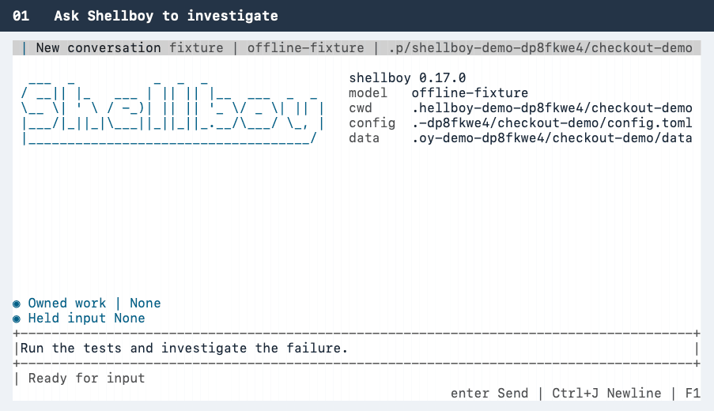

# Shellboy

**A local-first terminal agent for long-running, resumable, multi-agent work.**

For work you cannot afford to lose, Shellboy gives the model a real shell and
saves conversations, accepted requests, command executions, failures, and
provenance locally. Keep commands running in the background or delegate tasks
to child Threads. Search saved history and pick up the work after an
interruption or restart, without assuming a stopped command will restart.



## What makes it different

- **Ask and reply as saved work:** When a model [asks you or another Thread for an answer](docs/guides/user-guide.md#ask-and-reply), Shellboy records who owes it. An unanswered request stays visible and can be followed up or handed on, even after a restart.
- **Long-running work:** Run [shells in the background](docs/guides/shell.md#foreground-and-background), [schedule commands](docs/guides/user-guide.md#schedule-a-command), and [manage services](docs/guides/user-guide.md#keep-a-command-running).
- **Resumable conversations:** Reopen a [Thread with its history and working directory](docs/guides/user-guide.md#conversations-and-work-states).
- **Recoverable failures:** After a restart, distinguish [saved requests from completed work](docs/guides/recovery-and-storage.md#distinguish-acceptance-from-completion) and inspect [typed failures](docs/guides/recovery-and-storage.md#typed-failures-and-next-actions) before choosing what to do next.
- **Inspectable history:** [Search an index](docs/guides/history-and-search.md#search-requires-a-separate-index), [read retained originals](docs/guides/history-and-search.md#finding-and-reading-original-content), [trace commands to saved output](docs/guides/history-and-search.md#linking-executions-and-history), [fork](docs/guides/history-and-search.md#forks-and-request-editing), or [compact](docs/guides/history-and-search.md#compaction-and-spill).
- **One executable:** Use the [TUI and CLI](docs/guides/user-guide.md#talking-without-the-tui) with [local SQLite storage](docs/guides/user-guide.md#storage-and-resources). [Shellboy Studio](https://github.com/tya5/shellboy-studio) is an optional browser UI that connects to a compatible Core.
- **Conversation API dialects:** Choose [Responses (default), Chat Completions, or Anthropic Messages](docs/guides/configuration.md#conversation-api-dialect) per connection. Dialect support does not guarantee compatibility with a particular provider.

## Ask and reply

If a model needs you to choose between two approaches, it can run
`shellboy message ask --text 'Should I fix this now or defer it?'`. Answer in the
TUI; Shellboy sends your answer back to that conversation and links it to the
original question. The same reply tracking works when one Thread asks another
Thread, whether or not it is a child.

The idea comes from work tracking: a question has an assignee and a status.
`message list --awaiting` shows replies still owed, even after a Turn ends. If
a duty closes without a reply, its saved status shows that outcome. You can
follow up or send a new Ask to someone else.

Agent Guide: [Reply to a request](docs/guides/agent-guide.md#reply-to-a-request),
[Ask the human for a decision](docs/guides/agent-guide.md#ask-the-human-for-a-decision),
and [Ask another Thread for work](docs/guides/agent-guide.md#ask-another-thread-for-work).

> **Safety:** Shellboy has no command sandbox or per-command approval.\
> Model commands run with the owner's OS privileges.\
> Use a dedicated account, container, or VM for valuable work. See the [full safety model](docs/guides/user-guide.md#safety-model).

## Quick start

1. [Download Shellboy](#download) and put it on your PATH. Run `shellboy config init` and edit the reported `config_path`: set the API root and model ID, and set the named credential variable in your terminal if required. See [first setup](docs/guides/configuration.md#first-setup-without-an-owner).
2. Run `shellboy config check`. It checks the model catalog, not whether the endpoint accepts conversations.
3. In a sample folder you're comfortable sharing with your endpoint, run `shellboy` and ask: "Read this folder's README and summarize it in three bullets. Do not change files." This sends a model request and may incur charges. To reopen the Thread later, press Ctrl+T or use `/threads`.

## Download

Use the [latest release](https://github.com/tya5/shellboy/releases/latest) for
macOS Apple Silicon, Linux x64, or native Windows x64. The installers verify SHA-256
and install without sudo. Download and read the script before running it:

Bash (macOS or Linux):

```bash
curl -fsSL https://github.com/tya5/shellboy/releases/latest/download/install.sh -o install.sh
cat install.sh
sh install.sh
export PATH="$HOME/.local/bin:$PATH"
```

Windows PowerShell 5.1 or PowerShell 7:

```powershell
Invoke-WebRequest -UseBasicParsing https://github.com/tya5/shellboy/releases/latest/download/install.ps1 -OutFile install.ps1
Get-Content .\install.ps1
.\install.ps1
$env:Path = "$env:LOCALAPPDATA\Programs\shellboy;$env:Path"
```

These PATH changes apply to the current terminal. Adjust the directory if you
used `SHELLBOY_INSTALL_DIR` or extracted the binary elsewhere. If PowerShell
blocks the script, you can use the manual download instead of changing your
execution policy. The shell launching Shellboy and the shell used for model
commands are separate choices; see [native Windows and WSL setup](docs/guides/configuration.md#starting-on-each-platform).
Inside WSL, use the Linux build.

For a manual install, download the matching archive and `SHA256SUMS` from the
**same release**. Check the hash before extracting. In the examples, replace
`VERSION` with the version in your downloaded filename and compare the result
with that filename's line in `SHA256SUMS`:

```bash
# macOS Apple Silicon
shasum -a 256 shellboy-VERSION-aarch64-apple-darwin.tar.gz
# Linux x64
sha256sum shellboy-VERSION-x86_64-unknown-linux-gnu.tar.gz
```

```powershell
Get-FileHash .\shellboy-VERSION-x86_64-pc-windows-msvc.zip -Algorithm SHA256
```

Extract the verified archive and put its executable directory on PATH. Check
which binary the terminal finds with `shellboy --version`.

## Use it again

Open Shellboy with the same data directory to find your saved Threads. Use
`/threads` or Ctrl+T to return to one, or `/new` to start a fresh draft. The
interface defaults to English; [Configuration](docs/guides/configuration.md)
explains `[ui] language` and how to select Japanese.

- [User Guide](docs/guides/user-guide.md) ([Japanese](docs/guides/user-guide.ja.md)) for everyday tasks.
- [Recovery and Storage](docs/guides/recovery-and-storage.md) if a request fails or you are unsure whether it was accepted.
- [Guide index](docs/guides/README.md) and [CLI Reference](docs/guides/cli-reference.md) for commands and examples. `shellboy docs list` works offline without an owner.
- [Agent Guide](docs/guides/agent-guide.md) for models working inside Shellboy.

## Compatibility and upgrading

Shellboy is pre-1.0. The [release notes](https://github.com/tya5/shellboy/releases)
for the version you intend to run describe its supported behavior, configuration,
protocol and storage-schema changes. See [known limitations](docs/development/known-limitations.md)
for current limits and [verification records](docs/validation/acceptance.md) for
what has actually been tested.

### Upgrading

Before replacing an installation, read the target release notes, stop the owner
completely, and take a consistent backup of the selected data directory. First
write-capable startup can upgrade its databases. Do not open upgraded data with
an older binary; to roll back, restore the pre-upgrade backup into a separate data
directory. Check the executable version and intended data directory before
starting the new owner. Replacing a file alone does not replace a running owner.

## Development

To build from source, follow [development setup](docs/development/setup.md) for
the pinned Rust toolchain, platform prerequisites, and checks. From the repository,
`cargo build --locked` builds the executable. See the
[effective specification](docs/design/effective-spec.md) and [AGENTS.md](AGENTS.md)
before contributing.

## License

[MIT](LICENSE)
